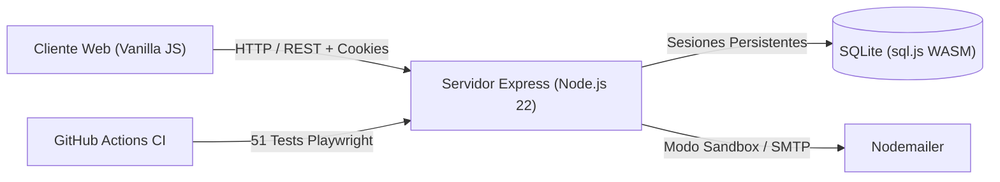

# DispoDocente — Reporte de Estado Actual del Proyecto

**Fecha de generación:** 4 de noviembre de 2026  
**Repositorio:** [GitHub - Gueremy/para-pima-domi-](https://github.com/Gueremy/para-pima-domi-)  
**Rama principal:** `main` | **Último Commit:** `11f2ad6`  
**Estado General:** **Listo para Producción y Demostración (CI 100% Verde)**

---

## 1. Resumen Ejecutivo

DispoDocente ha completado con éxito la refactorización integral y estabilización de seguridad, arquitectura y aseguramiento de calidad (QA). Se solventaron todas las vulnerabilidades críticas (P0), se optimizó el almacenamiento y persistencia de datos (P1), se crearon herramientas para demostración interactiva de portafolio y se alcanzó una suite de pruebas automatizadas con cobertura total ejecutándose en integración continua (GitHub Actions).



---

## 2. Estado de Calidad y Pruebas Automatizadas (QA & CI)

El proyecto cuenta con un pipeline de Integración Continua (CI) en GitHub Actions completamente funcional y validado.

* **Pipeline:** GitHub Actions (`.github/workflows/ci.yml`)
* **Runner:** `ubuntu-22.04` (Node.js 22 LTS)
* **Última corrida verificada:** [Run #41955372230](https://github.com/Gueremy/para-pima-domi-/actions/runs/41955372230) — **Conclusión: `success`**
* **Resultados de la Suite:** **51 de 51 pruebas aprobadas (100% PASS)**

| Módulo Evaluado | Pruebas | Estado | Aspectos Clave Validados |
| :--- | :---: | :---: | :--- |
| **1. Autenticación** | 8 |  Aprobado | Login, logout, registro exclusivo de estudiantes, bloqueo de autorregistro docente/admin, persistencia de sesión. |
| **2. Búsqueda y Filtros** | 6 |  Aprobado | Búsqueda con debounce, filtros por carrera y disponibilidad, apertura modal, visibilidad condicional de suscripciones. |
| **3. Disponibilidad Docente** | 2 |  Aprobado | Toggle ON/OFF en tiempo real, sincronización inmediata en la base de datos y la interfaz pública. |
| **4. Tickets y Consultas** | 9 |  Aprobado | Creación de tickets (presencial y escrita), respuestas del docente, agendamiento con fecha y generación de archivo `.ics`. |
| **5. Gestión de Perfiles** | 5 |  Aprobado | Actualización de bio, asignaturas, ramos, contacto institucional, y gestión de slots de horarios. |
| **6. Panel Administrativo** | 6 |  Aprobado | Restricción de acceso RBAC, estadísticas globales, creación segura de docentes y eliminación protegida de cuentas. |
| **7. Casos Límite (Edge Cases)** | 4 |  Aprobado | Validación de payloads corruptos, campos obligatorios, fechas de reunión requeridas y manejo de errores 400/404. |
| **8. Seguridad y Hardening** | 11 |  Aprobado | Erradicación de XSS reflejado/almacenado, control de acceso IDOR, rate limiting, prevención de Host Header Injection y protección contra auto-eliminación del último admin. |

---

## 3. Matriz de Correcciones y Mejoras Implementadas

### Seguridad (P0)
* **SEC-01 (Bloqueo de Elevación de Privilegios):** El registro público `/api/auth/register` restringe estrictamente el rol a `estudiante`. Cualquier solicitud que intente asignar rol `docente` o `admin` es rechazada con código `400 Bad Request`. Los docentes ahora se crean exclusivamente mediante el panel de administración autenticado (`POST /api/admin/docentes`).
* **SEC-02 (Mitigación Total de XSS):** Se implementó la utilidad centralizada `escapeHtml()` en `public/js/shared.js`. Se reemplazó la interpolación directa en `innerHTML` por nodos DOM seguros o cadenas escapadas en todas las vistas (`admin.js`, `docente.js`, `estudiante.js`, `shared.js`).
* **SEC-03 (Almacén de Sesiones Persistente):** Se creó el adaptador `SQLiteSessionStore` (`server/session-store.js`), conectando `express-session` a la tabla `sessions` de SQLite. Las sesiones no se pierden al reiniciar o desplegar el servidor.
* **SEC-04 (Protección contra IDOR en Tickets y Calendarios):** Se protegió el endpoint `GET /api/tickets/:id/ics` requiriendo autenticación obligatoria y validando que el usuario solicitante sea el estudiante o el docente titular del ticket.
* **SEC-05 (Hardening HTTP y Headers):** Se agregaron cabeceras `Content-Security-Policy`, `X-Content-Type-Options: nosniff`, `X-Frame-Options: SAMEORIGIN` y `Referrer-Policy`. Se configuró el límite de tamaño de carga útil en `100kb`.
* **SEC-06 (Restablecimiento Seguro de Contraseñas):** Los tokens de restablecimiento se almacenan hasheados mediante `SHA-256`, tienen expiración de 1 hora, rate limiting, revocación de sesiones previas al cambiar la clave y utilizan `APP_BASE_URL` para prevenir envenenamiento de encabezado Host.

### Persistencia y Lógica de Negocio (P1)
* **DATA-01 (Escritura Atómica en Base de Datos):** La persistencia en disco de `sql.js` (WebAssembly) ahora utiliza archivos temporales (`database.sqlite.tmp-*`) seguidos de un reemplazo atómico con `fs.renameSync()`, eliminando el riesgo de corrupción ante cortes abruptos.
* **DATA-02 (Transacciones con Rollback):** Se implementó `db.transaction()` nativo para operaciones críticas compuestas (baja de usuarios, reasignación de roles).
* **DATA-03 (Siembra Idempotente):** Las funciones `ensureUser`, `ensureDocente` y `ensureEstudiante` comprueban e insertan individualmente cada registro, garantizando que el entorno esté completo sin colisiones de inicialización.
* **MAIL-01 (Modo Sandbox de Correo):** Con `DEMO_MODE=true`, `mailer.js` redirige los correos a la consola del servidor en vez de fallar por credenciales SMTP no configuradas.

### Demostración y Experiencia de Usuario (P2)
* **FEAT-01 (Acceso Rápido Demo 1-Click):** En `login.html`, cuando `DEMO_MODE=true`, se muestran botones directos para ingresar de inmediato como *Estudiante*, *Docente* o *Administrador*, ideal para presentaciones y reclutadores.
* **FEAT-02 (Coordinación de Reuniones y Exportación .ics):** Se añadió un selector `datetime-local` en el panel docente para coordinar reuniones con fecha y hora específicas, generando archivos de calendario compatibles con Google Calendar, Outlook y Apple Calendar bajo el estándar RFC 5545.

---

## 4. Cuentas Preconfiguradas para Pruebas y Demostración

| Rol | Correo Electrónico | Contraseña | Propósito |
| :--- | :--- | :--- | :--- |
| **Administrador** | `admin@universidad.cl` | `Admin123!` | Gestión total, creación de docentes, métricas. |
| **Docente** | `docente@universidad.cl` | `Docente123!` | Gestión de disponibilidad, respuesta de tickets, agendamiento. |
| **Estudiante** | `estudiante@universidad.cl` | `Estudiante123!` | Búsqueda de profesores, envío de tickets y suscripciones. |
| **Docente Adicional** | `ana.garcia@universidad.cl` | `docente123` | Docente con horario y tickets demo. |
| **Docente Adicional** | `carlos.lopez@universidad.cl` | `docente123` | Docente part-time no disponible. |

---

## 5. Estructura de Archivos Clave

```text
├── .github/
│   └── workflows/
│       └── ci.yml                # Configuración de CI en GitHub Actions
├── scripts/
│   ├── seed-admin.js             # Inicializador de cuenta administrador
│   └── seed-demo.js              # Inicializador de datos demo para portafolio
├── proyecto/
│   ├── public/                   # Frontend estático vanilla seguro
│   │   ├── index.html            # Búsqueda pública de docentes
│   │   ├── login.html            # Inicio de sesión y botones demo
│   │   ├── estudiante.html       # Panel de estudiante
│   │   ├── docente.html          # Panel docente y respuesta con calendario
│   │   ├── admin.html            # Panel de control de usuarios y métricas
│   │   └── js/                   # Scripts de interfaz con escapeHtml
│   ├── server/                   # Backend Express
│   │   ├── db.js                 # Capa SQLite atómica e idempotente
│   │   ├── session-store.js      # Store de sesiones persistente
│   │   ├── mailer.js             # Gestor de correos con modo sandbox
│   │   ├── index.js              # Servidor principal y middlewares de seguridad
│   │   └── routes/               # Endpoints REST de la aplicación
│   ├── tests/
│   │   └── dispodocente.spec.js  # 51 tests e2e en Playwright
│   ├── playwright.config.js      # Configuración de Playwright con webServer
│   ├── package.json              # Dependencias y scripts
│   └── .env.example              # Plantilla de variables de entorno
└── README.md                     # Documentación profesional de portafolio
```

---

## 6. Próximos Pasos Recomendados (Fase 4: Despliegue)

1. **Hosting Recomendado:**
   * **Railway / Render:** Plataformas idóneas para desplegar aplicaciones Node.js con almacenamiento persistente o volumen montado para `database.sqlite`.
2. **Variables de Entorno para Producción:**
   * `NODE_ENV=production`
   * `SESSION_SECRET`: Generar una clave criptográfica de 64 caracteres (`node -e "console.log(require('crypto').randomBytes(32).toString('hex'))"`).
   * `APP_BASE_URL`: La URL pública definitiva del despliegue (ej. `https://dispodocente.onrender.com`).
   * `DEMO_MODE=true`: Mantenerlo activo si el despliegue es para evaluación o portafolio.
   * `EMAIL_USER` y `EMAIL_PASS`: Opcional, solo si se desea enviar correos reales vía SMTP institucional.
